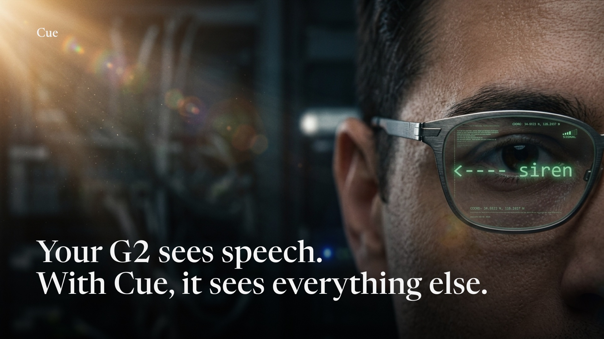
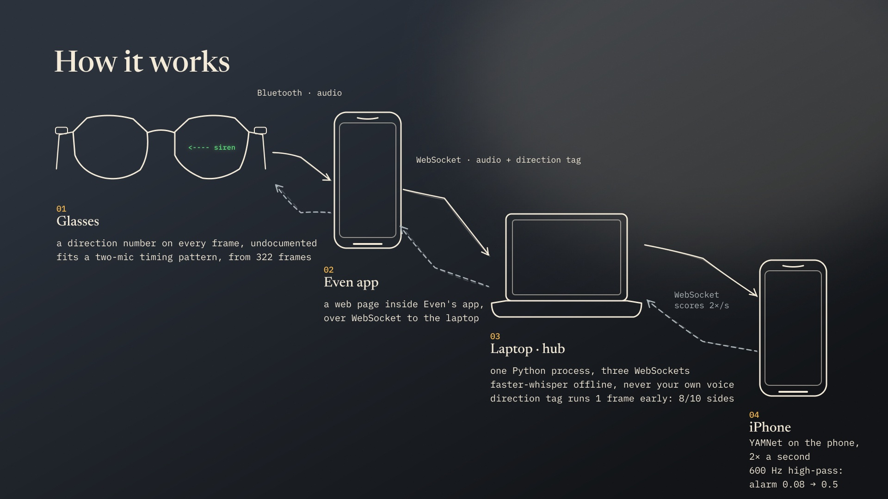
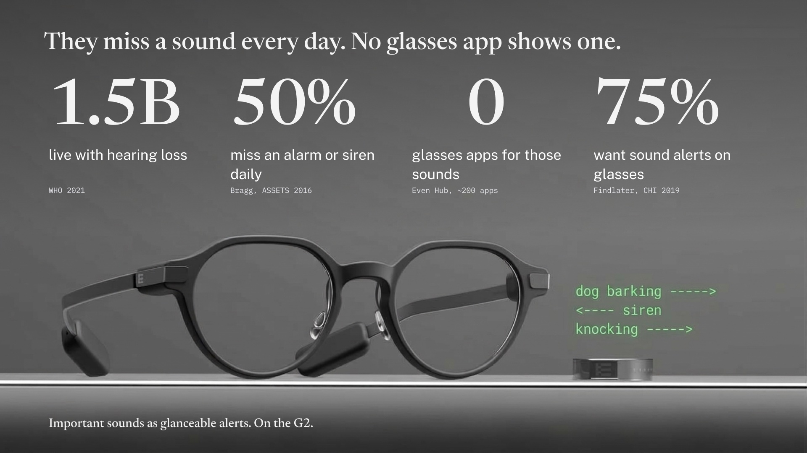
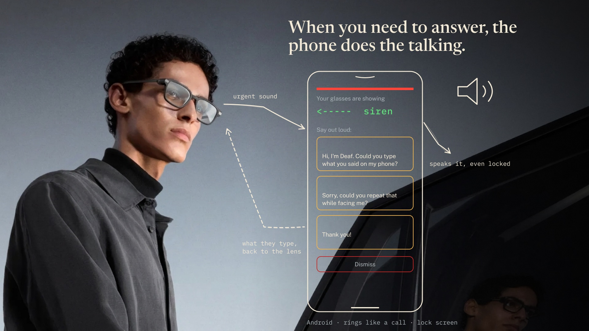

# Cue

[](https://youtu.be/71S9_XT-4Dg)

**[Watch the demo](https://youtu.be/71S9_XT-4Dg)** on a real G2.

Sound awareness for deaf and hard-of-hearing people, on Even Realities G2
smart glasses.

The glasses stay blank. When a sound you cannot hear matters, one line appears
in your line of sight saying what it was and which side it came from, then the
display goes blank again. When someone talks to you, their words appear under
an arrow to where they stand. When you need to answer, your phone rings like a
call, shows the sound and three replies, and speaks the one you press.

Built in 24 hours at LA Hacks AI Hackathon, UCLA, 17 to 18 October 2026, for
the Beyond the Digital track and the Even Realities challenge. The full record
(problem, design, measurements, every decision and why) is in `PRD.md`.

## Why glasses

A phone is too slow: by the time you take it out and look, the sound is over.
The G2 puts the cue where you are already looking, hands free. It has no
speaker, which costs a deaf user nothing. Even's built-in Conversate mode
captions speech but does not say that a doorbell rang or which side a voice
came from. Cue does both, with no hardware beyond the glasses and a phone.

## What it does

- Detects doorbell, knock, siren, alarm, car horn, dog bark, clap, and snap.
  Alarms and sirens take the whole display until they stop.
- Shows direction from the glasses' own microphone array: left or right.
  Front and behind read the same to the G2 and are drawn as "center".
- Captions anyone else who speaks, under the arrow for their side. The
  wearer's own voice is never captioned. Any sound replaces the captions.
- Lets the wearer choose, on the glasses, which sounds to see and how loudly
  each alerts: tap the touchpad for the menu, swipe to a sound, tap to cycle
  off / normal / medium / critical, tap DONE. Alarm and siren are always on.
- Rings the wearer's Android phone like an incoming call for critical and
  medium sounds, with the sound, its direction, and one button per reply.
  A reply is spoken aloud; "please type" opens a page over the lock screen
  for the other person to type on.

## How it works



```
G2 glasses ──Bluetooth──▶ phone: Even app + plugin/ ──WebSocket──▶ laptop: server/ ──▶ phone: audio_classification/
 4 mics, direction tag      forwards audio, draws HUD        ◀── HUD state    hub, rules     ◀── YAMNet scores
                                                                     │
                                                                     └──▶ Android: android-companion/
                                                                          rings, speaks replies
```

| folder | what | who |
|---|---|---|
| `plugin/` | the Even Hub app: streams glasses audio up, draws one line on the lenses, the on-glasses menu | Wendy |
| `server/` | the hub: YAMNet label map and thresholds, direction from the G2 tag, the state machine, live captions, mock mode | Nikhil; state machine spec, Dara |
| `audio_classification/` | TensorFlow Lite audio example with `EarshotLink.swift`: runs YAMNet on an iPhone, returns scores to the hub | Nikhil |
| `android-companion/` | rings like a call on urgent sounds, speaks replies, type-here page over the lock screen | Iurii |
| `tools/` | `eval.py` scores the pipeline on saved clips; `dirtest.py` reads the direction tag at each snap | Dara |
| `docs/` | `ARCHITECTURE.md` (the sound path end to end), `BRIDGE.md` (glasses-to-phone protocol), `RESEARCH.md`, eval and direction results, deck copy | |

## Run it

Everything on one Wi-Fi network. Use a phone hotspot; venue Wi-Fi usually
blocks phone-to-laptop traffic.

1. **Hub**, on a laptop. Prints the addresses the other pieces connect to.
   ```bash
   cd server
   python3 -m venv .venv && .venv/bin/pip install -r requirements.txt
   .venv/bin/python main.py --stt whisper      # offline captions, 1 to 2 s behind; first run downloads the model
   # or: DEEPGRAM_API_KEY=... .venv/bin/python main.py --stt deepgram   (about 0.5 s behind, needs internet)
   # or: .venv/bin/python main.py --mock       (cycles every HUD state, no audio; for plugin work)
   ```
2. **Classifier**, on an iPhone. Open
   `audio_classification/ios/AudioClassification.xcworkspace`, run it, tap the
   status text, enter `ws://LAPTOP_IP:8000/ws/classifier`, choose "Use glasses
   audio". No iPhone? `server/fake_classifier.py --model ../audio_classification/ios/AudioClassification/TFLite/yamnet.tflite`
   runs the same model on the laptop.
3. **Glasses app.**
   ```bash
   cd plugin && npm install
   # app.json → permissions → network → whitelist: the hub's exact http:// and ws:// origins
   npm run dev
   npx evenhub qr --url http://LAPTOP_IP:5173   # scan from the Even app
   ```
   Beta install: `npm run build && npx evenhub pack app.json dist -o cue.ehpk`,
   upload at https://evenhub.evenrealities.com to a Beta group containing your
   Even account email, then on the phone: Me, Beta tester, install. The app
   needs only the `g2-microphone` permission; no keys.
4. **Companion**, on an Android phone. Build per `android-companion/README.md`,
   then in the app: Connection, `ws://LAPTOP_IP:8000/ws/pendant`, Apply.

To measure instead of run: `python3 -m venv .venv && .venv/bin/pip install numpy ai-edge-litert && .venv/bin/python tools/eval.py`.

## Results

| | |
|---|---|
| Detection, 22 test clips | alarm 4/4, siren 3/3, dog 3/3, zero false cues on 6 noise clips |
| Sound to HUD state | about 1 s for alarms and sirens |
| Direction, 16 snaps at 1 m | correct side 8 of 10 |

Knocks and most doorbells are lost to the high-pass filter that alarms need
through the G2 microphones. A measured two-path fix reaches 19 of 22 and is
documented, not shipped. Details and caveats in `docs/eval-2026-10-17.md` and
`docs/direction-test.md`.

## Pitch deck

Demo video: https://youtu.be/71S9_XT-4Dg





## Team

Dara Miao (USC), Iurii Kolyadin (UC Irvine), Nikhil Marisetty (UT Dallas),
Wendy Wang (UCLA).

## License

MIT. Test clips in `server/clips/` keep their own licenses, listed in
`server/clips/SOURCES.md`. The project was called Earshot until Sunday
morning; code identifiers kept that name.
